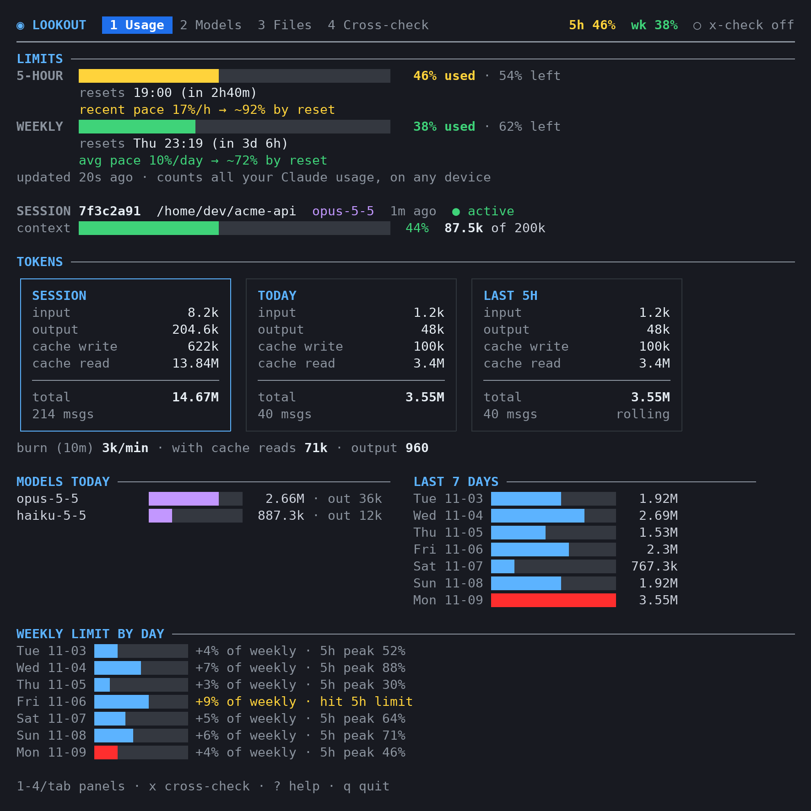
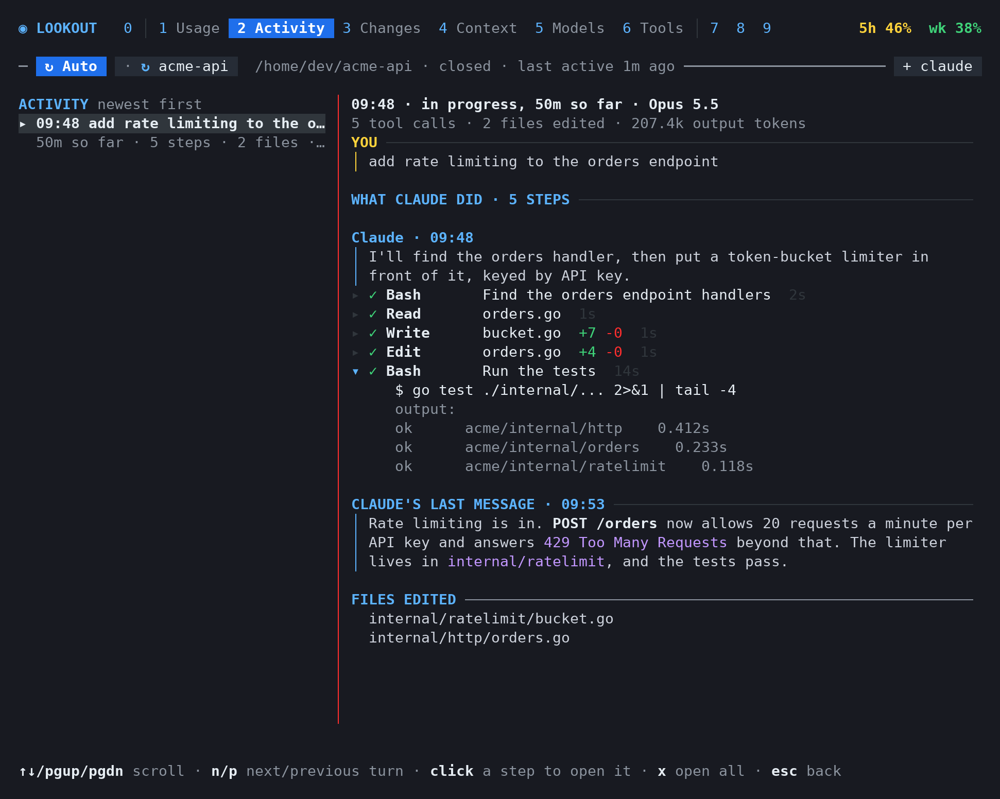

# Lookout

A terminal dashboard that runs **beside** an interactive [Claude Code](https://docs.anthropic.com/en/docs/claude-code) session, for example in a tmux split. It shows your usage limits and token usage, which files changed, what Claude did in each turn, what's filling the context window, suggests when to switch models, and lets you browse your config and memory files.

> **Unofficial.** Lookout is an independent open-source project. It is not affiliated with, endorsed by, or supported by Anthropic. "Claude" and "Claude Code" are trademarks of Anthropic.





## Quick start

```sh
go install github.com/romero927/lookout/cmd/lookout@latest   # install (or grab a release binary)
tmux split-window -h -l 50% 'lookout --here'                   # open it beside Claude Code
lookout statusline install --print                             # paste the snippet into ~/.claude/settings.json
```

## What it is (and isn't)

Lookout is a **dashboard, not a wrapper**:

- It **never calls Claude**. It doesn't use `claude -p`, the Agent SDK, or the Anthropic API, and it never types into Claude Code through a pty or scripted input. All of your Claude usage stays on your normal interactive limits.
- It **only reads** what Claude Code writes to disk (`~/.claude/`), plus what Claude Code itself passes to an optional status line command.
- It **never handles credentials**. It doesn't read `~/.claude/.credentials.json`, and the Files panel refuses to open it.
- It **sends nothing anywhere**. No network calls, no telemetry. The only programs it starts are `git` (read-only `diff`, `status` and `log`, for the Changes panel), a desktop notifier for alerts, a clipboard tool when you copy a command, your `$EDITOR` if you enable editing, and your own status line command if you wrap it.
- It **never types into Claude Code**. Commands it offers are copied for you to paste. Copying goes to the OS clipboard through `xclip`, `xsel`, `wl-copy`, `pbcopy` or `clip.exe`. On Linux, install one (`sudo apt install xclip`); without one, Lookout falls back to tmux's paste buffer (paste with your prefix, then `]`) or the terminal's clipboard, and says so. The mouse works too: click a tab, or an item to open it, scroll what's under the pointer, and drag to select text, which is copied when you let go (hold Shift for the terminal's own selection).

## Panels

| # | Panel | What it shows |
|---|-------|---------------|
| 1 | **Usage** | Your 5-hour and weekly limits with a pace projection, plus token counts for the session, today and the week. |
| 2 | **Activity** | Each prompt you sent and everything Claude did for it: messages, tool calls, edits and subagent work. |
| 3 | **Changes** | Every file that changed during the session, with its diff or commits. |
| 4 | **Context** | What fills the context window, the largest items, and how to free up room. |
| 5 | **Models** | The current model, a suggested one with a reason, and when `/compact` or a fresh session is worth it. |
| 6 | **Tools** | Every tool Claude used, with error and denial counts and each call's input and output. |
| 7 | **Skills** | Skills, slash commands and subagents available to Claude Code, and how to run them. |
| 8 | **Files** | Browse `settings.json`, `CLAUDE.md` files and auto-memory (read-only by default). |
| 9 | **Cheatsheet** | Claude Code commands to copy and paste, including ones for the session on screen. |

Full detail for each panel: [docs/panels.md](docs/panels.md).

Keys: `1`–`9` or `tab` switch panels · `s` picks which session to show (`a` in the picker follows the latest again) · `P` pins the session shown, or unpins · `↑↓`/`jk` move · `enter` focuses a viewer · `esc` goes back · `c` copies (Context, Skills, Cheatsheet) · `y` copies an ID (a file's commit in Changes, a session in the picker) · `e` edits (if enabled) · `R` restarts · `?` help · `q` quits.

**Alerts.** When a limit passes 80% or 95%, or your pace would reach it before the reset, the dashboard rings the terminal bell (tmux marks the window), sends a desktop notification (`notify-send` on Linux, `osascript` on macOS) and shows the alert in the footer. Each alert fires once per limit window, even across restarts and several open dashboards. Tune or turn them off under `[alerts]`.

**New builds.** If the `lookout` binary is replaced while the dashboard runs (say, after `make build`), the header shows `↻ R restart`, and `R` restarts into the new build in place.

## Install

Requires Go 1.26+ to build from source. That minimum comes from the pure-Go SQLite driver (`modernc.org/sqlite`) and its dependencies; Lookout's own code needs only Go 1.22. With `GOTOOLCHAIN=auto`, the default, an older `go` downloads 1.26 automatically. The result is a single static binary (pure Go, no cgo).

```sh
go install github.com/romero927/lookout/cmd/lookout@latest
# or
git clone https://github.com/romero927/lookout && cd lookout && make build   # → ./bin/lookout
```

Prebuilt binaries for Linux, macOS and Windows are attached to [releases](https://github.com/romero927/lookout/releases).

### Run it beside Claude Code

```sh
tmux split-window -h -l 50% 'lookout --here'  # focus on the session in this directory (or a parent or subfolder)
# or just:
lookout                                        # follows your most recently active session
lookout stats                                  # one-shot text summary, no TUI
```

From a checkout, `scripts/split.sh [project-dir]` starts a tmux session with `claude` on the left and Lookout on the right. Running it again reattaches to that session.

### Show your real limits (recommended)

Claude Code passes your subscription's 5-hour and weekly usage (percent used and reset time) to its [status line](https://docs.anthropic.com/en/docs/claude-code/statusline) command. To have Lookout receive them, print the snippet and add it to `~/.claude/settings.json` yourself:

```sh
lookout statusline install --print
```

Claude Code then runs `lookout statusline` after each update. It saves only a few numbers: limit percentages and reset times, context use, and the session cost. They go in one small file per session under `limits/` in the data directory, so sessions on different accounts stay separate, plus a per-day total in `history.json`. It also prints a short line under your prompt, e.g. `Opus 5.5 · ctx 12% · 5h 42% (resets 2h23m) · week 23%`. Limits are reported for Claude.ai subscriptions only.

**Already have a status line?** Settings allow only one, so Lookout can wrap yours instead of replacing it. When `settings.json` already has a `statusLine` command, `lookout statusline install --print` prints a wrapped version:

```json
{ "statusLine": { "type": "command", "command": "/path/to/lookout statusline --wrap '~/bin/my-statusline.sh'" } }
```

Lookout passes your command the same JSON on stdin, prints its output, then adds its own line after it. `--order before` puts Lookout's line first, `--sep TEXT` changes the separator (default ` · `), and `--timeout DUR` limits how long your command may run (default `2s`). If your command fails or times out, Lookout's line still prints, and the error goes to `logs/hook.log`.

**API key or pay-as-you-go accounts** have no 5-hour or weekly limits, so Lookout shows the session's cost so far instead (in the Usage panel and the status line, e.g. `Opus 5.5 · ctx 12% · $1.84`). Alerts, the per-day limit chart and limit-aware model suggestions stay off; everything else works the same.

To stop using it, remove the `statusLine` entry from `~/.claude/settings.json`, then delete the binary and Lookout's config and data folders (`lookout paths` lists them).

## Configuration

`lookout config init` writes a commented `config.toml` containing every default (`lookout config default` prints it without writing, `lookout config path` shows where it goes), and `lookout paths` shows where each file lives:

| | Linux | macOS | Windows |
|---|---|---|---|
| Config | `$XDG_CONFIG_HOME/lookout/config.toml` (`~/.config/lookout`) | `~/Library/Application Support/lookout/config.toml` | `%AppData%\lookout\config.toml` |
| Data (suggestion log, limits, alert state, backups, logs) | `$XDG_DATA_HOME/lookout` (`~/.local/share/lookout`) | `~/Library/Application Support/lookout` | `%AppData%\lookout\data` |

`LOOKOUT_CONFIG_DIR` and `LOOKOUT_DATA_DIR` override either directory.

Highlights:

- `[models]`: every threshold (repeated edits, tool errors, multi-file turns, long prompts, frustration phrases, simple-turn streaks, short prompts, context %) and the model tier order (`model_tiers = ["haiku", "sonnet", "opus"]`), and how long the suggestion log keeps rows (`log_days = 90`).
- `[usage]`: `history_days` (how far back the first scan reads transcripts, default 30), `burn_window_minutes` (the tokens-per-minute window, default 10) and `block_hours` (the rolling window and estimated block length, default 5).
- `[usage.price_weights]`: per-model prices used to weight tokens for the session-share estimate, overriding the built-in ones. Keys are substrings of the model ID (the longest match wins), e.g. `"opus-5-5" = { input = 4, output = 20, cache_write = 5, cache_read = 0.20 }`.
- `[files] allow_edit = true` turns on `e`, which opens the file in `$VISUAL`/`$EDITOR`. A timestamped backup is written to the data directory's `backups/` first, and is discarded if you didn't change anything. `extra_files` lists more files to browse, e.g. `["~/.claude/keybindings.json"]`.
- `[alerts]`: `bell`, `desktop`, `thresholds` (default `[80, 95]`; `[]` turns them off) and `pace`.
- `[ui] theme`: `auto`, `dark` or `light`. Inside tmux the terminal can't be asked, so dark is assumed. `LOOKOUT_THEME` overrides it.

Lookout honours `CLAUDE_CONFIG_DIR`.

## What Lookout stores

Lookout writes only to its own config and data directories (run `lookout paths` to see them). It never writes under `~/.claude/` itself (with editing turned on, your `$EDITOR` does). Everything below stays on your computer.

| File | Directory | What's in it | How long it's kept |
|---|---|---|---|
| `config.toml` | config | Your settings. Written only by `lookout config init`. | Until you delete it |
| `lookout.db` (plus `-wal` and `-shm` files) | data | SQLite log of model suggestions, one row each: time, session ID, current and suggested model, action, the reason and the signals behind it, context tokens, the model you used next and when, and the outcome (`smooth` or `rough`). The reason and signals can name a file (its base name) and, for the short-prompt signal, quote your latest prompt when it is at most `short_prompt_chars` (default 40) characters long. Written by the dashboard, readable only by you. | 90 days (`[models] log_days`; `0` keeps everything). Older rows are deleted when the dashboard starts |
| `limits/<session-id>.json` | data | What Claude Code passed to the status line for that session: 5-hour and weekly percentages and reset times, up to 720 one-a-minute samples of them (about 12 hours, for the pace), context use, and the cost Claude Code reports. Written by `lookout statusline`. | Deleted after 8 days without an update |
| `history.json` | data | Per local day: percentage points of the weekly and 5-hour limits used, and the day's 5-hour peak. Also the last reading of each limit window. Written by `lookout statusline`. | 35 days |
| `alerts.json` | data | Which limit alerts already fired (window, threshold, time), so they don't repeat. Written by the dashboard. | Dropped a week after the window resets |
| `backups/<path>.<time>.bak` | data | A copy of a file taken before you edit it with `e` (only with `[files] allow_edit = true`). | Removed right away if you changed nothing; otherwise until you delete it |
| `logs/hook.log`, `logs/hook.log.1` | data | Status line problems: unreadable input, failed saves, and a wrapped command's failure, with that command. | At 1 MB, `hook.log` becomes `hook.log.1`, replacing the older one (about 2 MB at most) |

The first time it runs, Lookout also moves folders left by its old name (`overwatch`) to the locations above. Deleting the config and data directories removes everything.

## How the numbers are computed

- **Source.** JSONL transcripts under `~/.claude/projects/<project>/<session>.jsonl`, plus `…/<session>/subagents/*.jsonl` for subagents. Usage comes from `message.usage` on `assistant` records, and the model from `message.model`.
- **Deduplication.** Claude Code writes one API response as several lines (one per content block), each repeating the same usage. Lookout counts each `message.id` once.
- **Limits.** The percentages and reset times are exactly what Claude Code passes to the status line. They cover all your Claude usage, on any device, but only update when Claude Code refreshes its status line. The 5-hour pace is the change over the last 30 minutes (idle time counts); the weekly pace is the average since the week started. The projection assumes that pace holds.
- **Weekly limit per day** (in Last 7 days). Each time Claude Code reports limits, the rise since the previous reading is added to that local day. After a window resets, the new window's usage counts in full. The first reading ever only sets a starting point, so the chart fills in from the day you connect the status line.
- **Session share of a limit.** Claude Code reports one percentage for the whole account, so Lookout splits it by the session's share of the Claude Code usage recorded on this computer during the window. Tokens are weighted by each model's API list price (input, output, cache write and cache read separately), so an Opus token counts for more than a Haiku token. The prices are used only as ratios; no dollar figure is shown or stored. They are hardcoded in `internal/usage/share.go` from Anthropic's published API prices and updated by hand in Lookout releases, and models Lookout doesn't know yet are weighted like Sonnet 4.6. Anthropic doesn't publish how each model counts against the limits, so this is an estimate. If prices change before Lookout is updated, override them under `[usage.price_weights]`.
- **Usage block (estimated, fallback).** Shown only when the status line isn't connected yet: a 5-hour window that starts at the first message after a break, floored to the hour. It is a heuristic, not Anthropic's actual limit meter.
- **Context.** With the status line connected, this is the percentage Claude Code itself reports. Otherwise it is estimated: input + cache read + cache write of the latest main-chain response, against the configured window (default 200k, or 1M once a session goes past it).

### Model suggestions and your prompts

The Models panel's rules read your prompts from the transcripts on disk: their length (`long_prompt_chars`, `short_prompt_chars`) and whether the latest prompt contains one of the `frustration_phrases` (a case-insensitive text match, checked only on prompts of 300 characters or fewer, so a long request that quotes an error isn't a complaint). This analysis runs entirely inside Lookout on your computer. No prompt text, or anything else, leaves the machine: Lookout makes no network calls. The only place prompt text is kept is the suggestion log, as described in [What Lookout stores](#what-lookout-stores).

**"Went smoothly", exactly.** The suggestion log marks a suggestion `smooth` or `rough` only when all of these hold:

1. It was an upgrade or a downgrade (a "keep" is never judged).
2. You followed it: the model of the first main-session response after the suggestion was logged contains the suggested `/model` alias (e.g. `sonnet`).
3. Three turns have happened on the new model: the first 3 prompts you sent in that session that got at least one response, counting from 1 minute before that first response.

Lookout then adds up the failing tool results in those 3 turns. A tool result counts as failing when Claude Code marks it as an error, or when its output looks like a failing test, build or crash (`--- FAIL`, `FAIL`, `FAILED`, "N tests failed", a Python traceback, `AssertionError`, a Go `panic:`, `npm ERR!`, a Rust `error[E…]`, `BUILD FAILED`, "compilation failed"). Subagent tool calls aren't counted. Fewer than `tool_error_threshold` (default 3) is `smooth`; that many or more is `rough`. Outcomes are judged by the dashboard while it shows that session, so a suggestion in a session you never open in Lookout stays unjudged.

### ⚠️ The transcript format is undocumented

Claude Code's transcript format isn't a public API and can change with any Claude Code update. Lookout reads only the fields it needs, ignores unknown fields and record types, skips malformed lines, and never crashes on bad input. If recent lines start failing to parse, a **! PARSER** warning appears in the header and the token figures may be incomplete until Lookout is updated. Lookout was developed against Claude Code 2.1.x.

## Development

```sh
make build    # static binary in ./bin
make install  # same, into $GOBIN (default ~/go/bin)
make test     # go test ./... (race detector on)
make lint     # golangci-lint, or go vet + gofmt if it isn't installed
make screenshot  # re-render docs/screenshot.png and docs/activity.png from synthetic data (needs Python 3 + Pillow)
make snapshot    # local release build with goreleaser, nothing published
```

All test fixtures are **synthetic**. Never commit real transcripts. To benchmark against your own data locally without copying it into the repo:

```sh
LOOKOUT_BENCH_FILE=~/.claude/projects/<project>/<session>.jsonl go test ./internal/transcript -bench ReadFile
LOOKOUT_BENCH_LOAD=1 go test ./internal/app -bench Load
```

## License

[MIT](LICENSE)
