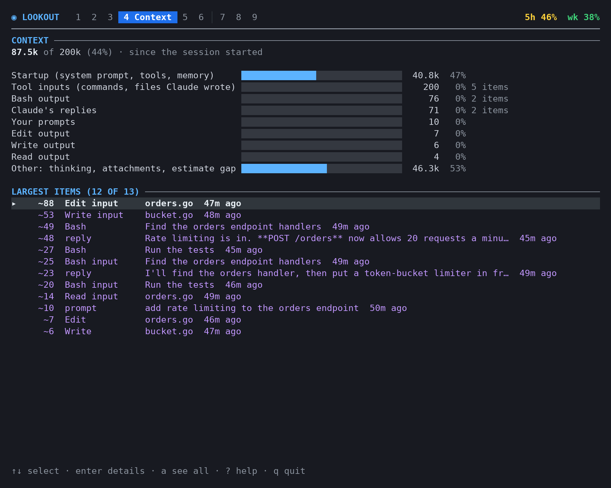
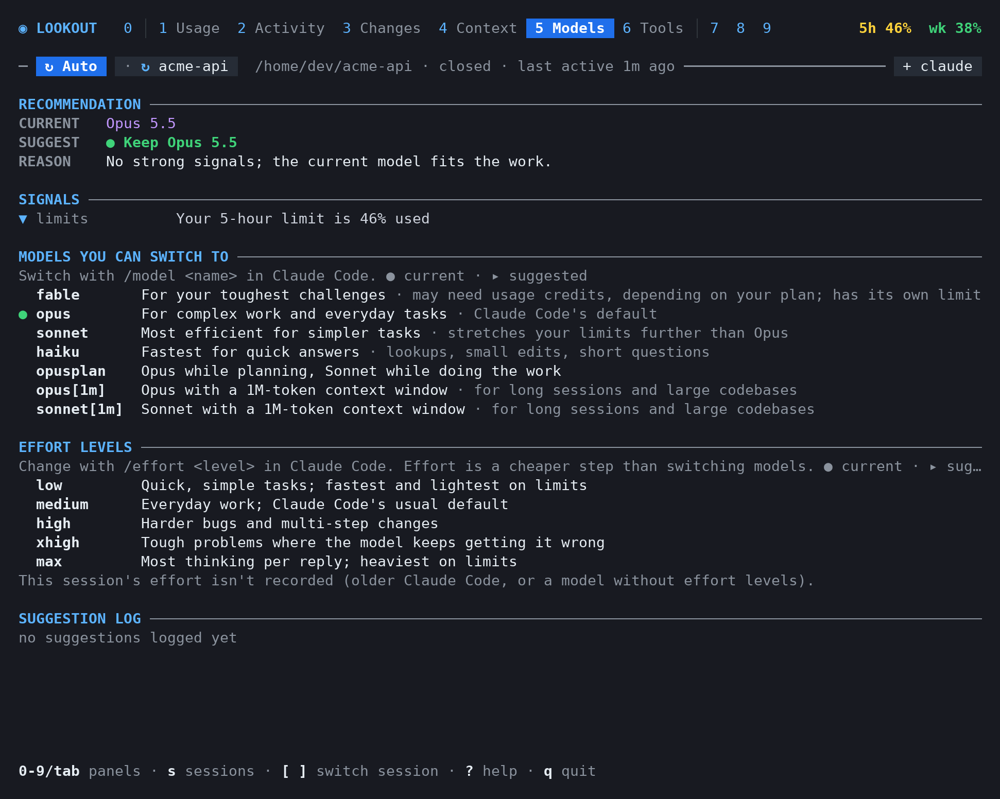
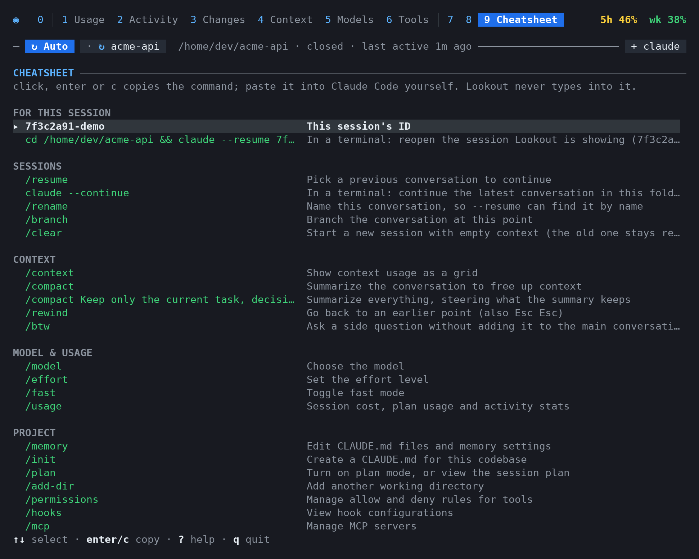

# Lookout

A terminal dashboard you keep open **next to** [Claude Code](https://docs.anthropic.com/en/docs/claude-code) (for example, in a tmux split) to see what's going on while you work:

- how much of your **5-hour and weekly limits** you've used, and whether you're on pace to run out
- **what Claude did** for each prompt, and **which files changed**
- **what's filling the context window**, and how to free up room
- **when to switch models or effort level**
- your **config, `CLAUDE.md` and memory files**

It only reads files Claude Code already writes. It never talks to Claude, never touches your credentials, and sends nothing over the network.

> **Unofficial.** Lookout is an independent open-source project. It is not affiliated with, endorsed by, or supported by Anthropic. "Claude" and "Claude Code" are trademarks of Anthropic.


## Quick start

**1. Install it**

```sh
go install github.com/romero927/lookout/cmd/lookout@latest
```

No Go? Download a binary for Linux, macOS or Windows from [releases](https://github.com/romero927/lookout/releases).

**2. Open it beside Claude Code**

From the folder you're running Claude Code in:

```sh
tmux split-window -h -l 50% 'lookout --here'
```

If Claude Code isn't running there yet, the session panels show "Waiting for a Claude Code session" until it starts; Lookout picks it up on its own. A session you've just started counts too: until you send its first message, Lookout waits on it rather than showing an older one.

**3. Connect your real limits** (recommended)

```sh
lookout statusline install --print
```

This prints a snippet. Paste it into `~/.claude/settings.json` (Lookout never edits that file for you). [Why this step matters](#connect-your-real-limits).

## Panels

Press `0`–`9` (or `tab`) to switch panels.

| # | Panel | What it shows |
|---|-------|---------------|
| 0 | **Sessions** | Every running session by title: working, needs you, finished or idle, with context, limit share and your last prompt; then recent ones with model, size and cost. Jump to one, or to its tmux pane. |
| 1 | **Usage** | Your 5-hour and weekly limits with a pace projection, plus token counts for the session, today and the week. |
| 2 | **Activity** | Each prompt you sent and everything Claude did for it: messages, tool calls, edits and subagent work. |
| 3 | **Changes** | Every file that changed during the session, with its diff or commits, plus other things Claude's commands and tools changed: pushes, API writes, deploys, MCP tools that create or send. |
| 4 | **Context** | What fills the context window, the largest items, and how to free up room. |
| 5 | **Models** | The current model, a suggested one with a reason, and when `/compact` or a fresh session is worth it. |
| 6 | **Tools** | Every tool Claude used, with error and denial counts and each call's input and output. |
| 7 | **Skills** | Skills, slash commands and subagents available to Claude Code, and how to run them. |
| 8 | **Config** | Your `settings.json`, `CLAUDE.md` files, auto-memory and Lookout's own `config.toml` (read-only by default). |
| 9 | **Cheatsheet** | Claude Code commands to copy and paste, including ones for the session on screen. |

More on each panel: [docs/panels.md](docs/panels.md). All screenshots below use made-up data.

**Activity:** each prompt, then every step Claude took for it. Open a step to see its full command and output.


**Context:** what's taking up the context window, and the largest single items.



**Models:** whether to switch model or effort level, and why, with every option explained.



**Cheatsheet:** Claude Code commands to copy, including ones filled in for the session on screen.



### Keys

| Key | Does |
|-----|------|
| `0`–`9`, `tab` | Switch panels |
| `[` `]` | Step through the session tabs: `↻ Auto`, then each running session |
| `↑` `↓` / `j` `k` | Move |
| `enter` / `esc` | Open / go back |
| `s` | Open Sessions to pick which session to show (`a` there goes back to following the latest) |
| `P` | Pin the session on screen so it stays put, or go back to `↻ Auto` |
| `N` | In tmux: open a new Claude Code in the folder of the session on screen (or click `+ claude`) |
| `c` | Copy a command (Context, Skills, Cheatsheet) |
| `y` | Copy an ID (a commit in Changes, a session in Sessions), or an action's command in Changes |
| `g` | Go to the session's tmux pane (Sessions) |
| `e` | Edit the file (Config, only if [enabled](#configuration)) |
| `o` | Open your usage page on claude.ai (Usage), or the selected file's folder (Config, Changes) |
| `R` | Restart |
| `?` | Help |
| `q` | Quit |

The mouse works too: click a tab or an item, scroll what's under the pointer, and drag to select text (copied when you let go). Hold Shift to use your terminal's own selection instead.

**Copying.** Lookout never types into Claude Code; commands it offers are copied for you to paste. It uses `xclip`, `xsel`, `wl-copy`, `pbcopy` or `clip.exe`. On Linux, install one (`sudo apt install xclip`). Without one, it falls back to tmux's paste buffer (paste with your prefix, then `]`) or the terminal's clipboard, and tells you which.

**Alerts.** When a limit passes 80% or 95%, or your pace would hit it before the reset, Lookout rings the terminal bell, sends a desktop notification (`notify-send` on Linux, `osascript` on macOS) and shows the alert at the bottom. Each alert fires once per limit window, even across restarts. It does the same when a session other than the one on screen stops on a permission prompt or finishes. Change or turn them off under `[alerts]`.

### Several sessions at once

Lookout follows the session you last sent a message to (or clicked into, in tmux), so a session busy in the background doesn't pull the view away, but it switches to any session that stops on a permission prompt or question until you answer. The line under the panel tabs has a tab per session. The first, `↻ Auto`, is lit while Lookout follows, and the session it follows is marked with a blue `↻`. Click any other session (or pick one in Sessions, closed ones too) and it gets its own tab, pinned with `◆` (or `◷` for a closed session), while Auto keeps following in the background; click `↻ Auto` to go back. Each tab shows the session's state: `●` working, `▲` needs you, `✓` finished while you were elsewhere, `○` idle. `[` and `]` step through the tabs, `0` opens the Sessions panel with all of them side by side, and `g` there jumps to a session's tmux pane. In tmux, `+ claude` at the right end (or `N`) opens a new Claude Code next to the session on screen, in its folder. `lookout --session ID` opens on one session, e.g. one dashboard per tmux pane. [More](docs/panels.md#which-session-is-on-screen).

**Updates while running.** If the `lookout` binary is replaced while it runs (say, after `make build`), the header shows `↻ R restart`. Press `R` to switch to the new build.

## Install

```sh
go install github.com/romero927/lookout/cmd/lookout@latest
# or build from a clone:
git clone https://github.com/romero927/lookout && cd lookout && make build   # → ./bin/lookout
```

Or download a prebuilt binary from [releases](https://github.com/romero927/lookout/releases).

Building needs Go 1.26 or newer. (That comes from the SQLite library it uses; with the default `GOTOOLCHAIN=auto`, an older `go` downloads 1.26 for you.) The result is a single binary with no other dependencies.

## Commands

| Command | Does |
|---------|------|
| `lookout` | Open the dashboard, following your most recently active session |
| `lookout --here` | Open it focused on the session in this folder (or a parent or subfolder) |
| `lookout --session ID` | Open it on one session (the start of its ID is enough) |
| `lookout stats` | Print a one-off text summary instead of the dashboard |
| `lookout statusline install --print` | Print the `settings.json` snippet that connects your limits |
| `lookout config init` | Write a `config.toml` with every default, commented |
| `lookout paths` | Show every folder Lookout uses |
| `lookout update` | Check for a newer release |

From a clone, `scripts/split.sh [project-dir]` opens a tmux session with `claude` on the left and Lookout on the right. Run it again to reattach.

## Connect your real limits

Claude Code shares your 5-hour and weekly usage (percent used and reset time) only with its [status line](https://docs.anthropic.com/en/docs/claude-code/statusline) command. To let Lookout see them, make Lookout that command:

```sh
lookout statusline install --print
```

Paste the printed snippet into `~/.claude/settings.json`. From then on, Claude Code runs `lookout statusline` after each update, and you get:

- **A status line under your prompt**, e.g. `Opus 5.5 · effort medium · ctx 12% · 5h 42% (resets 2h23m) · week 23%`
- **Real limits** in the Usage panel, plus alerts and the per-day chart

Lookout saves only a few numbers from this: limit percentages and reset times, context use and session cost. See [what Lookout stores](docs/how-it-works.md#what-lookout-stores).

Without this step Lookout still works, but it can only estimate your limits from token counts.

### Already have a status line?

Claude Code allows only one, so Lookout can wrap yours instead of replacing it. If your `settings.json` already has one, `lookout statusline install --print` prints a wrapped version:

```json
{ "statusLine": { "type": "command", "command": "/path/to/lookout statusline --wrap '~/bin/my-statusline.sh'" } }
```

Your command gets the same input as before. Its output prints first, then Lookout's line.

| Option | Does | Default |
|--------|------|---------|
| `--order before` | Put Lookout's line first | after |
| `--sep TEXT` | Separator between the two | ` · ` |
| `--timeout DUR` | How long your command may run | `2s` |

If your command fails or times out, Lookout's line still prints and the error goes to `logs/hook.log`.

### API key or pay-as-you-go accounts

These accounts (including enterprise accounts billed by usage) have no 5-hour or weekly limits, so Lookout shows the session's **cost so far** instead, e.g. `Opus 5.5 · effort medium · ctx 12% · $1.84`. Limit alerts, the per-day chart and limit-based model suggestions are off; everything else works the same.

- The cost is Claude Code's own estimate at list API prices, so negotiated pricing isn't reflected.
- It's decided per session: a session with a cost but no limits after its first reply shows its cost, even if another account on the same computer has limits.
- The Usage panel shows dollars beside the tokens too: today, the last 5 hours, each model and each of the last 7 days. These are Lookout's estimates (marked `~`): tokens priced at API list prices, counting only pay-as-you-go sessions, so a subscription on the same computer isn't priced in.

### Uninstall

1. Remove the `statusLine` entry from `~/.claude/settings.json`.
2. Run `lookout paths` and delete the config and data folders it lists.
3. Delete the `lookout` binary.

## Privacy and safety

Lookout is a **dashboard, not a wrapper**.

- **It never calls Claude.** No `claude -p`, Agent SDK or Anthropic API. Your usage stays on your normal interactive limits.
- **It never types into Claude Code.** Commands are copied for you to paste.
- **It only reads.** It reads what Claude Code writes under `~/.claude/`, plus what Claude Code passes to the status line. It writes only to [its own folders](docs/how-it-works.md#what-lookout-stores).
- **It never touches credentials.** It doesn't read `~/.claude/.credentials.json`, and the Config panel refuses to open it.
- **It sends nothing anywhere.** No telemetry and no network calls, with one opt-in exception: with `[updates] check = true`, it asks GitHub once a day for the latest version number. That request carries nothing about you or your usage.

The only other programs it runs are `git` (read-only `diff`, `status` and `log`, for the Changes panel), a desktop notifier for alerts, a clipboard tool when you copy, `tmux` when you press `g` to go to a session's pane (it only changes which pane is shown), your `$EDITOR` if you turn on editing, and your own status line command if you wrap it.

## Configuration

Lookout works without a config file. To customize it:

```sh
lookout config init      # writes config.toml with every default, commented
lookout config default   # prints the defaults without writing anything
lookout config path      # shows where config.toml goes
```

| | Linux | macOS | Windows |
|---|---|---|---|
| Config | `~/.config/lookout/config.toml` (`$XDG_CONFIG_HOME`) | `~/Library/Application Support/lookout/config.toml` | `%AppData%\lookout\config.toml` |
| Data | `~/.local/share/lookout` (`$XDG_DATA_HOME`) | `~/Library/Application Support/lookout` | `%AppData%\lookout\data` |

`LOOKOUT_CONFIG_DIR` and `LOOKOUT_DATA_DIR` override these. Lookout also honours `CLAUDE_CONFIG_DIR`.

The settings you're most likely to change:

| Section | Setting | What it does |
|---------|---------|--------------|
| `[alerts]` | `thresholds`, `bell`, `desktop`, `pace`, `sessions` | When and how alerts fire. Thresholds default to `[80, 95]`; `[]` turns them off. `sessions = false` stops alerts about other sessions. |
| `[files]` | `allow_edit = true` | Lets `e` open a file in `$VISUAL`/`$EDITOR`. A backup is saved first (and discarded if you change nothing). |
| `[files]` | `extra_files` | More files to show in Config, e.g. `["~/.claude/keybindings.json"]`. |
| `[updates]` | `check = true` | Checks GitHub once a day for a new release and shows it in the header (e.g. `↑ v0.6.4`). Off by default. |
| `[ui]` | `theme` | `auto`, `dark` or `light`. Inside tmux, dark is assumed. `LOOKOUT_THEME` overrides it. |
| | `colors` | `auto`, `truecolor`, `256`, `16` or `none`. `auto` uses 256 colors in Terminal.app (which can't show 24-bit color before macOS 26), including inside tmux, where Lookout asks tmux which terminal its client runs in, and treats plain `TERM=xterm` (XQuartz) as 256 colors. If colors look wrong, especially under tmux in a terminal Lookout can't identify (tmux 3.x passes 24-bit color to every terminal by default), set `256`. `LOOKOUT_COLOR` overrides it. |
| | `new_claude` | Where `N` opens a new Claude Code in tmux: `split` (the default) splits the pane of the session on screen, side by side when it's wide (when it can't, the largest Claude Code pane in Lookout's window, else Lookout's own); `window` opens a new window. |
| `[models]` | thresholds, `model_tiers`, `effort_levels`, `default_effort`, `log_days` | When the Models panel suggests a change. Tiers default to `["haiku", "sonnet", "opus", "fable"]`; effort levels to `["low", "medium", "high", "xhigh"]`, with `"medium"` as the default. The suggestion log keeps 90 days. |
| `[usage]` | `history_days`, `burn_window_minutes`, `block_hours` | How far back the first scan reads (30 days), the tokens-per-minute window (10 min), and the estimated usage block length (5 h). |
| `[usage.price_weights]` | one entry per model | Override the model prices (dollars per million tokens) used to estimate each session's share of a limit and, on pay-as-you-go accounts, the dollar estimates, e.g. `"opus-5-5" = { input = 4, output = 20, cache_write = 5, cache_read = 0.20 }`. Keys match part of the model ID; the longest match wins. |

**Colors look wrong?** Lookout guesses how many colors your terminal shows. It uses 256 in Terminal.app, even inside tmux: Terminal.app before macOS 26 can't show 24-bit color, and tmux 3.x passes 24-bit color through to every terminal by default (`terminal-features` includes `*:RGB`), so dim text and stray teal backgrounds appear. When Lookout can't identify the terminal tmux runs in (for example tmux on another computer over ssh), set `LOOKOUT_COLOR=256` (or `truecolor`, `16`, `none`) or `colors = "256"` under `[ui]`.

## How it works

[docs/how-it-works.md](docs/how-it-works.md) has the details:

- [What Lookout stores](docs/how-it-works.md#what-lookout-stores), and for how long
- [How the numbers are computed](docs/how-it-works.md#how-the-numbers-are-computed): limits, pace, each session's share, context
- [How model and effort suggestions work](docs/how-it-works.md#model-suggestions), including how your prompts are used

**⚠️ Heads-up:** Claude Code's transcript format isn't a public API and can change with any update. If Lookout stops reading it correctly, a **! PARSER** warning appears in the header and token figures may be incomplete until Lookout is updated. Built against Claude Code 2.1.x. [More](docs/how-it-works.md#the-transcript-format-is-undocumented).

## Development

```sh
make build       # binary in ./bin
make install     # same, into $GOBIN (default ~/go/bin)
make test        # go test ./... with the race detector
make lint        # golangci-lint, or go vet + gofmt if it isn't installed
make screenshot  # re-render the docs/ screenshots from synthetic data (needs Python 3 + Pillow)
make snapshot    # local release build with goreleaser, nothing published
```

All test fixtures are **synthetic**. Never commit real transcripts. To benchmark against your own data without copying it into the repo:

```sh
LOOKOUT_BENCH_FILE=~/.claude/projects/<project>/<session>.jsonl go test ./internal/transcript -bench ReadFile
LOOKOUT_BENCH_LOAD=1 go test ./internal/app -bench Load
```

## License

[MIT](LICENSE)
